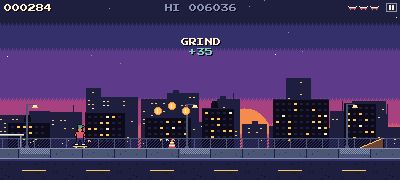

# PIXEL GRIND



An endless side-scrolling skateboarding game for phone browsers, in the style of an 80s/90s arcade cabinet. Tap to ollie, swipe to flip, land on rails to grind, chain tricks into combos.

**Play:** https://johaarbastar-hash.github.io/pixel-grind/ (landscape, one thumb; installable, works offline)

Vanilla JavaScript (ES modules) and Canvas 2D: no engine, no framework, no downloaded art or sound. Every sprite, the font, the music, the sound effects and the app icon are generated in code.

## How to play

Touching the screen pops; the direction you swipe picks the flip.

| Gesture | On the ground | In the air | On a rail |
|---|---|---|---|
| Tap | Ollie | Buffered: ollies the moment you land | Pop off |
| Swipe ← → ↓ ↑ | Ollie + kickflip / heelflip / pop shove-it / 360 flip | That flip (one more can queue) | Pop off + that flip |
| Nothing | Roll | Fall | Grind to the end |

- Land with the flip finished: clean. With 60 ms or less of spin left: SKETCHY, half points. More: bail.
- Kickers launch you high enough for two flips. Land on a rail or ledge and you grind automatically.
- A combo lasts from leaving the ground to landing; grinds keep it alive. Score = trick points x the number of different tricks. Repeats in one combo score 50%, then 25%.
- Combos of 300 / 600 / 1,000 / 2,500 / 5,000 are NICE / RAD / SICK / GNARLY / LEGENDARY, each with its own word, sound and hit-stop.
- 3 boards per run, and no extra boards. When the last one goes you can buy a continue with coins (200, then 400; at most 2 per run).
- Coins on the ideal line are worth 50 points each and go in your wallet. Spend them in the SHOP (on the title or game-over screen) on hats, shirts, trousers and boards. Tap an item to try it on, then BUY.
- SHARE sends a challenge link: your friend plays the same course with your score to beat.
- DAILY plays today's course, the same for everyone. Finishing a run on consecutive days builds a streak that pays a coin bonus once a day.
- Keyboard: Space = ollie, arrows = flips, P / Esc = pause, M = mute, S = shop, D = daily run, C = continue.

## Design decisions

### One-thumb controls that never feel late
- The ollie fires on touch-down, on the very next simulation tick. A swipe is recognised as soon as the finger has moved 20 px within 250 ms, without waiting for the lift, so ollie + flip is a single motion.
- Taps in the air are buffered for 120 ms, and you still get 80 ms of coyote time after rolling off a rail end.
- The pause button's touch area is several times bigger than its icon, and touches that start on it never ollie. Mute lives in the pause menu rather than as a second tiny on-screen button.
- The page is locked down: no scrolling, zooming, pull-to-refresh, text selection or long-press menus while you play.

### Fair by construction
- **Same run on every phone.** Obstacles spawn by world distance, never by screen width. Wider screens just see further ahead, and a seed replays any run exactly.
- **Hand-authored segments.** Obstacles come in 29 short patterns (`src/segments.js`), each tagged with the tier it unlocks at. Tiers unlock by run time, not score, so players who do lots of tricks aren't punished with harder obstacles.
- **Fairness rules in code:**
  - Spacing inside a segment stretches with speed.
  - The space between segments is never less than speed x (ollie airtime + 0.4 s), plus extra room after kickers and rail ends.
  - Gaps are at most 0.7 x speed x airtime wide.
  - The first 5 seconds are always clear.
- **Forgiving collisions.** Hitboxes are smaller than the sprites, and a 60 ms late-landing grace turns near-misses into sketchy landings instead of bails.

### A bot tests every pattern
The simulation (`run.js`, `world.js`, `player.js`) has no DOM access and its state can be cloned, so the autopilot (`src/bot.js`) plans by playing the future:
1. It rides on without input. If that stays safe, it waits.
2. Otherwise it tries popping at every tick before the predicted bail and keeps the timings that survive.
3. It picks the middle of the widest safe window, then checks a few jumps further ahead.

`npm run soak` sweeps every segment at every tier it can appear in, at that tier's slowest, middle and fastest speed. It then plays 10 simulated minutes per tier, which takes about 8 seconds of real time. Because the bot is frame-perfect and people aren't, surviving isn't enough: any jump with less than 0.1 s of timing slack fails the test. Every failure prints a URL that replays it in the browser.

The same bot plays the demo run behind the title screen.

### Physics set by feel
Config holds target feel (ollie airtime 0.6 s, apex 32 px, kicker airtime 0.9 s), and the code derives gravity (8 x apex / airtime²) and launch speed from it. The simulation runs on a fixed 60 Hz timestep with exact integration for constant gravity, so an ollie lasts exactly 36 ticks on every device. Every tuning number lives in `src/config.js`, and a debug panel edits them live on the phone.

### Pixel-perfect on any phone
- The game renders at 180 px tall and 320 to 400 px wide to match the screen's aspect ratio. It's then scaled up by a whole number measured in device pixels.
- A 20:9 phone in fullscreen is filled exactly: 2400x1080 is 400x180 at 6x.
- Notches and rounded corners are avoided with safe-area insets.
- Nothing is scaled or rotated at runtime: squash, stretch and tumbles are drawn frames. The one exception is the shop's 2x preview of the skater.

### Arcade shell
- **Start-up:** fake boot text once per session, then a title screen with the bot's demo run. Panels cycle through how to play, the high-score table and stats.
- **Day and night:** the sky goes from sunset to night in 4 palette swaps, never tints, so the 16-colour look holds.
- **Visual effects:** street lamps flicker on at dusk. Dust, grind sparks and token sparkles come from a fixed particle pool, so nothing is allocated mid-run. There's a screen shake and freeze frame on bails, and an optional CRT scanline overlay done in CSS.
- **High scores:** a top-10 table with 3-letter initials (swipe to change a letter, tap to confirm), a share button and saved stats.
- **Shop:** 28 pieces of gear in 4 slots (`src/gear.js`). Gear colours are named roles in the skater's sprite data, so changing gear just rebuilds the sprites in the new colours; hats are small overlays drawn on the head. Coins go into the wallet in memory as you pick them up, and the wallet is saved when a run pauses or ends.
- **Pausing:** the game auto-pauses when you switch apps or turn the phone upright, and resumes with a 3-2-1 countdown.
- **Sound:** synthesized with Web Audio, including a chiptune loop on a lookahead scheduler whose tempo steps up each tier.
- **App:** an installable web app with a service worker for offline play, versioned per build.

## Run it

```
npm install
npm run dev            # http://localhost:5173
npm run dev -- --host  # also on your phone, same Wi-Fi
npm run soak           # bot soak test
npm run build          # production build in dist/
npm run icons          # regenerate the app icons
```

Every push to `main` builds and deploys to GitHub Pages (`.github/workflows/deploy.yml`). The build id at the bottom right of the title screen shows which commit a phone is running.

### Debug tools
- `?debug=1` (or the backtick key) shows:
  - FPS, frame time and CPU time per frame
  - hitboxes, resolution, speed, flip state, tier, segment and seed
- **TUNE** panel (debug mode, bottom-left, or T):
  - live sliders for the gameplay numbers; COPY VALUES gives JSON to paste into `config.js`
  - toggles for invincible, slow motion, autopilot and a fixed tier, a button to spawn any segment next, and one to turn the tutorial back on
- URL options:
  - `?seed=N` fixes the seed, `?bot=1` turns on the autopilot, `?tutorial=1` forces the tutorial
  - `?tier=T&speed=V&seg=ID` gives soak-test replays
- Errors print in a red box on screen, since phones have no console.

## Layout

```
src/config.js     every tuning number
src/main.js       loop + state machine (boot, title, play, pause, countdown, initials, game over, shop)
src/run.js        one run: world + skater + collisions + score + boards   (no DOM)
src/world.js      scrolling, speed curve, tiers, segment spawning, tokens   (no DOM)
src/player.js     physics, flips, grinding, kickers, landing rules          (no DOM)
src/segments.js   hand-authored obstacle patterns with tiers                (no DOM)
src/bot.js        autopilot that plans by simulation                        (no DOM)
src/gear.js       shop catalogue: hats, shirts, trousers, boards            (no DOM)
src/shop.js       wallet, owned and worn gear, saved in storage
src/modes.js      challenge links, daily seed and record, streak
src/render.js     scaling, parallax, particles, skater frames
src/sprites.js    palette, sprites and background layers, all drawn in code
src/font.js       8x8 bitmap font
src/audio.js      synthesized SFX + music scheduler
src/ui.js         HUD, menus, title, game over, initials, shop
scripts/soak.mjs  bot soak test
```

The full design document is [skater-game-plan.md](skater-game-plan.md). Everything currently in the game is described in [docs/pixel-grind-overview.md](docs/pixel-grind-overview.md).
